# Spike: which layered layout design

This directory holds the prototype for SPIKE-18. It is not part of the crate. `scripts/task`
does not build it. The conclusion is in the Answer section of the item.

## Run it

```sh
cd spikes/layered-layout
cargo run --release -- draw   # writes pictures/<candidate>/<diagram>.svg and prints the scores
cargo run --release -- seed   # adds one thing to each diagram and counts what moves,
                              # then seeds each diagram with its own picture and no edit
```

Two runs give the same bytes. Four runs of `draw` gave identical files for every candidate.

## The candidates

| name | what it is | version | licence |
| --- | --- | --- | --- |
| own | our own Sugiyama pipeline, `src/own.rs`, 736 lines, no dependency | this directory | MIT |
| dagre | the `dagre` crate, a port of dagre.js | 0.1.2 | Apache-2.0 |
| graphlay | the `graphlay` crate | 0.4.0 | MIT or Apache-2.0 |
| elk | the `elk-layout` crate, a port of the ELK layered phases from Java | 0.12.2 | EPL-2.0 or GPL-3.0-or-later |

Every candidate reads the same graph (`src/model.rs`), with the same box sizes and the same
gaps. One renderer draws every picture (`src/svg.rs`) and one module scores every picture
(`src/measure.rs`). The adapters for the three crates are in `src/crates.rs`.

## The diagrams

The ten files in `corpus/` were written for this spike. The corpus of public flowcharts
from SPIKE-17 was not in the repository when the spike ran. `01-checkout` restates the links
and the group of `examples/checkout.horse`. The files use a subset of horsegirl: links, and
groups in braces. Six of the ten files have groups, and three of those nest groups.

The spike leaves out three things on purpose:

- Link labels. No candidate was asked to place one.
- A link that ends at a group. Every link ends at a thing.
- Real text widths. A box is `7.2 px` for each character plus `28 px`.

## Scores

- **overlaps**: pairs of boxes that overlap by more than half a pixel.
- **touching**: pairs of boxes that do not overlap and that have less than one pixel between
  them.
- **group faults**: things outside their group, things inside a group that is not theirs, and
  pairs of groups that overlap without one being inside the other.
- **links through a box**: links whose path enters a box that is not one of their two ends.
- **crossings**: points where two links cross.

| diagram | things | links | candidate | size | overlaps | touching | group faults | links through a box | crossings | bends | link length |
| --- | --- | --- | --- | --- | --- | --- | --- | --- | --- | --- | --- |
| 01-checkout | 9 | 9 | own | 1047 x 164 | 0 | 0 | 0 | 0 | 1 | 8 | 1042 |
| 01-checkout | 9 | 9 | dagre | 1083 x 178 | 0 | 0 | 0 | 0 | 0 | 7 | 874 |
| 01-checkout | 9 | 9 | graphlay | 1138 x 140 | 0 | 0 | 0 | 0 | 0 | 8 | 1368 |
| 01-checkout | 9 | 9 | elk | 984 x 110 | 0 | 0 | 0 | 0 | 0 | 8 | 973 |
| 02-ci-pipeline | 18 | 22 | own | 2089 x 268 | 0 | 0 | 0 | 0 | 0 | 30 | 3733 |
| 02-ci-pipeline | 18 | 22 | dagre | 2129 x 420 | 0 | 0 | 0 | 3 | 0 | 19 | 3936 |
| 02-ci-pipeline | 18 | 22 | graphlay | 2587 x 290 | 0 | 0 | 0 | 0 | 6 | 32 | 5927 |
| 02-ci-pipeline | 18 | 22 | elk | 2013 x 258 | 0 | 0 | 0 | 0 | 1 | 28 | 3966 |
| 03-order-states | 15 | 20 | own | 1754 x 132 | 0 | 0 | 0 | 0 | 1 | 52 | 4574 |
| 03-order-states | 15 | 20 | dagre | 1711 x 208 | 0 | 0 | 0 | 1 | 1 | 17 | 4227 |
| 03-order-states | 15 | 20 | graphlay | 1733 x 204 | 0 | 0 | 0 | 0 | 0 | 20 | 4214 |
| 03-order-states | 15 | 20 | elk | 1747 x 178 | 0 | 0 | 0 | 0 | 0 | 22 | 4392 |
| 04-data-pipeline | 19 | 22 | own | 1740 x 744 | 0 | 0 | 0 | 0 | 0 | 38 | 6498 |
| 04-data-pipeline | 19 | 22 | dagre | 1870 x 580 | 0 | 0 | 0 | 1 | 0 | 23 | 5162 |
| 04-data-pipeline | 19 | 22 | graphlay | 2023 x 321 | 0 | 0 | 0 | 0 | 3 | 37 | 7350 |
| 04-data-pipeline | 19 | 22 | elk | 1524 x 339 | 0 | 0 | 0 | 0 | 0 | 32 | 4713 |
| 05-sign-in | 15 | 20 | own | 1534 x 174 | 0 | 0 | 0 | 0 | 0 | 52 | 6064 |
| 05-sign-in | 15 | 20 | dagre | 1549 x 340 | 0 | 0 | 0 | 0 | 5 | 20 | 6316 |
| 05-sign-in | 15 | 20 | graphlay | 1706 x 288 | 0 | 0 | 0 | 0 | 0 | 22 | 6489 |
| 05-sign-in | 15 | 20 | elk | 1035 x 309 | 0 | 0 | 0 | 0 | 5 | 30 | 4183 |
| 06-cluster-request | 17 | 23 | own | 1846 x 450 | 0 | 0 | 0 | 0 | 9 | 38 | 4375 |
| 06-cluster-request | 17 | 23 | dagre | 1976 x 450 | 0 | 0 | 0 | 1 | 3 | 28 | 4132 |
| 06-cluster-request | 17 | 23 | graphlay | 2374 x 310 | 0 | 0 | 0 | 0 | 7 | 44 | 6297 |
| 06-cluster-request | 17 | 23 | elk | 1899 x 258 | 0 | 0 | 0 | 0 | 1 | 38 | 3558 |
| 07-compiler | 16 | 18 | own | 1362 x 260 | 0 | 1 | 0 | 0 | 1 | 42 | 4583 |
| 07-compiler | 16 | 18 | dagre | 1340 x 516 | 0 | 0 | 0 | 1 | 3 | 16 | 4181 |
| 07-compiler | 16 | 18 | graphlay | 1551 x 381 | 0 | 0 | 0 | 0 | 3 | 29 | 6787 |
| 07-compiler | 16 | 18 | elk | 1270 x 327 | 0 | 0 | 0 | 0 | 1 | 30 | 4439 |
| 08-module-deps | 22 | 37 | own | 933 x 378 | 0 | 0 | 0 | 0 | 22 | 88 | 8337 |
| 08-module-deps | 22 | 37 | dagre | 911 x 546 | 0 | 0 | 0 | 1 | 14 | 41 | 6585 |
| 08-module-deps | 22 | 37 | graphlay | 981 x 468 | 0 | 0 | 0 | 0 | 3 | 52 | 7499 |
| 08-module-deps | 22 | 37 | elk | 926 x 434 | 0 | 0 | 0 | 0 | 3 | 56 | 6524 |
| 09-incident | 24 | 31 | own | 2693 x 282 | 0 | 0 | 0 | 0 | 2 | 58 | 6857 |
| 09-incident | 24 | 31 | dagre | 2678 x 366 | 0 | 0 | 0 | 0 | 0 | 28 | 6774 |
| 09-incident | 24 | 31 | graphlay | 2693 x 384 | 0 | 0 | 0 | 0 | 0 | 28 | 7321 |
| 09-incident | 24 | 31 | elk | 2743 x 291 | 0 | 0 | 0 | 0 | 0 | 34 | 7656 |
| 10-platform | 34 | 44 | own | 1988 x 1128 | 0 | 3 | 0 | 0 | 44 | 112 | 25939 |
| 10-platform | 34 | 44 | dagre | 2200 x 1540 | 0 | 0 | 0 | 0 | 48 | 104 | 28689 |
| 10-platform | 34 | 44 | graphlay | 3330 x 980 | 0 | 0 | 0 | 0 | 137 | 152 | 47974 |
| 10-platform | 34 | 44 | elk | 2458 x 604 | 0 | 0 | 0 | 0 | 25 | 158 | 27611 |

| candidate | overlaps | touching | group faults | links through a box | crossings | bends |
| --- | --- | --- | --- | --- | --- | --- |
| own | 0 | 4 | 0 | 0 | 80 | 518 |
| dagre | 0 | 0 | 0 | 8 | 74 | 303 |
| graphlay | 0 | 0 | 0 | 0 | 159 | 424 |
| elk | 0 | 0 | 0 | 0 | 36 | 436 |

dagre returns control points for a curve. The picture draws straight lines between them, so
the bend count of dagre is not comparable with the others.

own draws four pairs of boxes with a gap of 0 px. Every candidate got a node gap of 24 px.

| diagram | upper box | lower box | shared edge |
| --- | --- | --- | --- |
| 07-compiler | `Checks` | `Lens` | y -92 |
| 10-platform | `Search index` | `Data lake` | y -754 |
| 10-platform | `Analytics sink` | `Notifier` | y -978 |
| 10-platform | `Cache` | `Accounts database` | y -814 |

The cause is in `place` in `src/own.rs`. A group has a marker (`Kind::Border`) in every rank
that the group spans. A pair of neighbours gets a gap of 0 px when one of the two is a marker.
The order phase can put the marker between two things of the group: rank 4 of `07-compiler`
is `Checks`, the marker of `Core`, `Lens`. Then nothing holds the two things 24 px apart.
The smallest input that shows the fault:

```text
G {
a, c, d, e
}
b -> e
d -> e
b -> a
```

own draws `e` at y -128 to -92 and `a` at y -92 to -56.

## The seed experiment

Each row adds one thing, `New step`, with one link from the middle thing of the file.
A cell is: things that moved, pairs of things that changed sides, and crossings in the new picture.

| diagram | things | own, no seed | own, seed | graphlay, no seed | graphlay, seed | elk, no seed | elk, seed | dagre |
| --- | --- | --- | --- | --- | --- | --- | --- | --- |
| 01-checkout | 9 | 3, 0, 1 | 4, 0, 1 | 6, 0, 0 | 6, 0, 0 | 7, 3, 0 | 9, 2, 2 | 5, 3, 0 |
| 02-ci-pipeline | 18 | 8, 30, 0 | 7, 8, 1 | 7, 0, 6 | 7, 0, 6 | 7, 8, 1 | 18, 33, 16 | 7, 21, 0 |
| 03-order-states | 15 | 6, 1, 1 | 6, 0, 1 | 7, 25, 0 | 15, 11, 0 | 15, 53, 0 | 0, 0, 2 | 14, 15, 2 |
| 04-data-pipeline | 19 | 18, 30, 0 | 6, 2, 6 | 10, 7, 7 | 10, 7, 7 | 10, 29, 0 | 19, 8, 8 | 18, 142, 1 |
| 05-sign-in | 15 | 1, 0, 0 | 3, 0, 2 | 1, 0, 0 | 1, 0, 0 | 9, 17, 5 | 9, 1, 22 | 13, 59, 1 |
| 06-cluster-request | 17 | 0, 0, 11 | 0, 0, 11 | 6, 9, 7 | 6, 9, 7 | 15, 88, 1 | 17, 7, 18 | 5, 0, 3 |
| 07-compiler | 16 | 6, 1, 1 | 15, 5, 1 | 16, 23, 1 | 16, 23, 1 | 14, 12, 1 | 14, 18, 17 | 14, 0, 3 |
| 08-module-deps | 22 | 12, 7, 26 | 3, 3, 38 | 9, 0, 3 | 16, 4, 3 | 9, 1, 3 | 10, 12, 44 | 12, 0, 14 |
| 09-incident | 24 | 2, 2, 2 | 0, 0, 5 | 9, 34, 0 | 24, 47, 0 | 8, 7, 0 | 13, 2, 18 | 12, 11, 1 |
| 10-platform | 34 | 13, 0, 44 | 24, 0, 44 | 16, 34, 127 | 16, 34, 127 | 34, 230, 26 | 34, 132, 126 | 34, 457, 63 |
| total | 189 | 69, 71, 86 | 68, 18, 110 | 87, 132, 151 | 117, 135, 151 | 128, 448, 37 | 143, 215, 273 | 134, 708, 88 |

No edit: each row seeds a diagram with its own picture. dagre has no input for positions.
A cell is: things that moved, the longest move in pixels, and crossings before and after.

| diagram | things | own | graphlay | elk |
| --- | --- | --- | --- | --- |
| 01-checkout | 9 | 0, 0, 1 to 1 | 0, 0, 0 to 0 | 9, 40, 0 to 2 |
| 02-ci-pipeline | 18 | 0, 0, 0 to 0 | 0, 0, 6 to 6 | 18, 201, 1 to 15 |
| 03-order-states | 15 | 0, 0, 1 to 1 | 0, 0, 0 to 1 | 0, 0, 0 to 2 |
| 04-data-pipeline | 19 | 6, 24, 0 to 3 | 0, 0, 3 to 3 | 19, 181, 0 to 7 |
| 05-sign-in | 15 | 2, 12, 0 to 4 | 0, 0, 0 to 3 | 9, 24, 5 to 20 |
| 06-cluster-request | 17 | 0, 0, 9 to 9 | 0, 0, 7 to 7 | 17, 132, 1 to 16 |
| 07-compiler | 16 | 6, 36, 1 to 4 | 0, 0, 3 to 3 | 14, 121, 1 to 16 |
| 08-module-deps | 22 | 4, 24, 22 to 31 | 0, 0, 3 to 3 | 3, 26, 3 to 42 |
| 09-incident | 24 | 0, 0, 2 to 2 | 0, 0, 0 to 5 | 13, 20, 0 to 17 |
| 10-platform | 34 | 15, 36, 44 to 44 | 0, 0, 137 to 137 | 34, 852, 25 to 125 |
| total | 189 | 33, 80 to 99 | 0, 159 to 168 | 136, 36 to 262 |

own fails the no-edit run: 33 of 189 things move when a diagram is seeded with its own picture.
Every longest move is a multiple of 12 px, the gap beside a bend. A bend has no seed in the
prototype, so the order phase sorts the bends again and they push the pinned things. A seed of
centres alone cannot hold a picture still. It must also carry the order of each layer, bends
included, or the position of each bend. The spike did not test such a seed.

How each candidate receives the earlier positions:

- **own**: `own::layout(graph, Some(seed))`. The seed is the earlier centre of each thing, and
  `None` for a new thing. The order phase pins seeded things: they keep the order of their
  earlier positions inside each layer. The place phase starts every seeded thing at its earlier
  position and moves it only when a constraint pushes it.
- **graphlay**: `Node::position` with `SeedMode::Structure`. The crate documents that it
  ignores positions in a graph with groups. The six files with groups give the same numbers
  with and without a seed, which confirms it.
- **elk**: the `x` and `y` of each node, with the `INTERACTIVE` strategy for cycle breaking,
  layering, crossing minimisation and node placement. Every group must set the same strategies
  or ELK refuses the graph. The new thing needs a position too.
- **dagre**: no input exists.

## Size and WebAssembly

One small program for each candidate, built with `opt-level = "s"`, LTO, `panic = "abort"`
and stripped. Every program builds for `wasm32-unknown-unknown`. The programs were built
outside the repository and are not kept.

| program | native, bytes | WebAssembly, bytes | crates in the tree, the candidate included | lines of Rust in the candidate |
| --- | --- | --- | --- | --- |
| no layout | 284648 | 22170 | 0 | 0 |
| own | 403960 | 130447 | 0 | 736 |
| dagre | 705304 | 404457 | 15 | 17329 |
| graphlay | 1058864 | 683635 | 11 | 41935 |
| elk | 4932680 | 4150165 | 63 | 125499 in the five crates that the layered phases need |

## The pictures

### 01-checkout

own

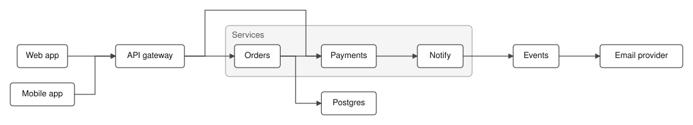

dagre

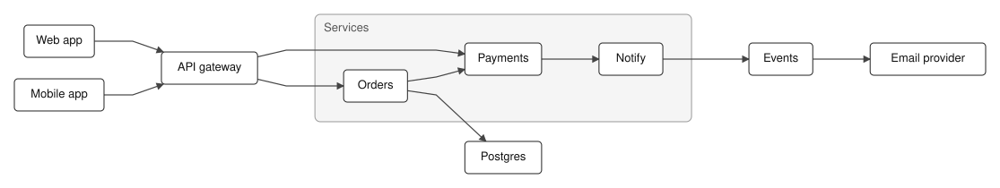

graphlay

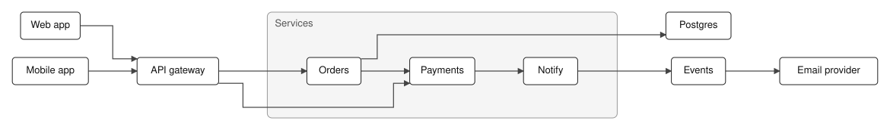

elk

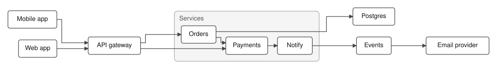


### 02-ci-pipeline

own

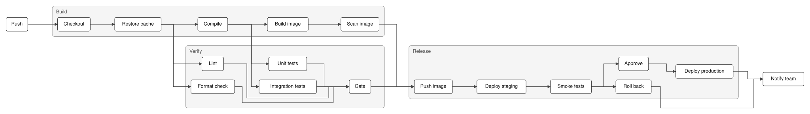

dagre

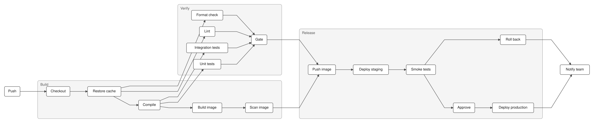

graphlay

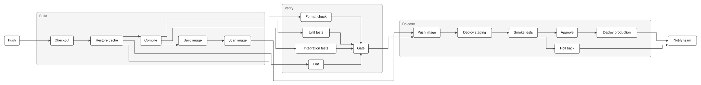

elk

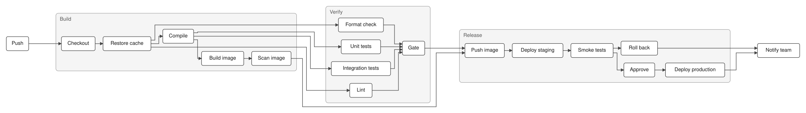


### 03-order-states

own

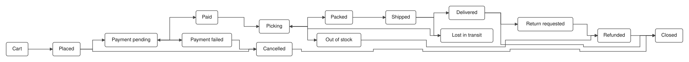

dagre

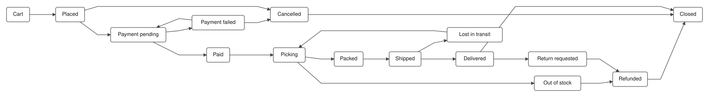

graphlay

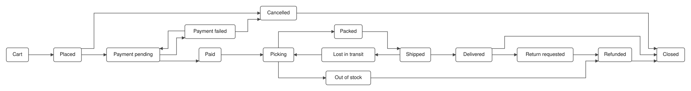

elk

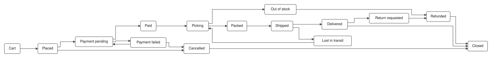


### 04-data-pipeline

own

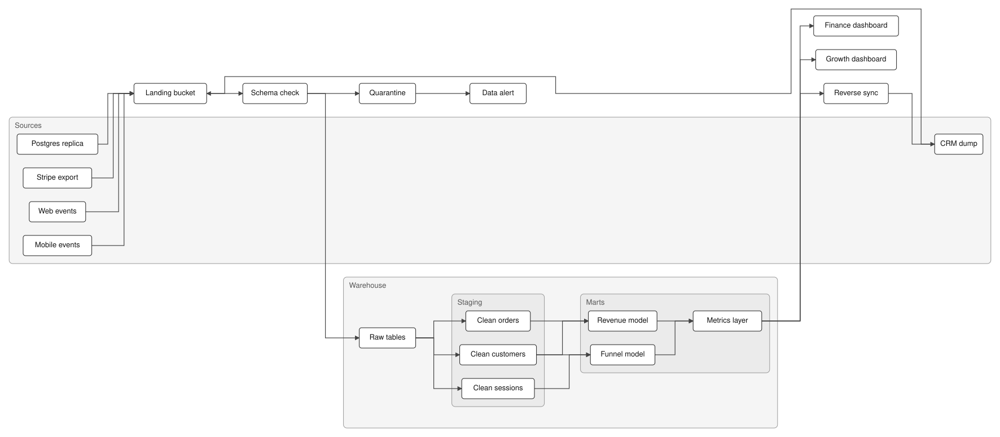

dagre

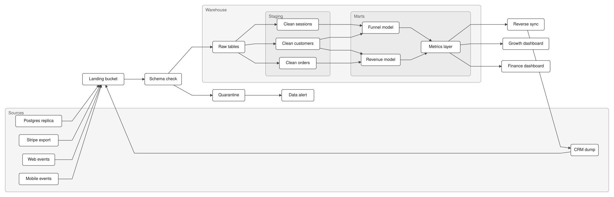

graphlay

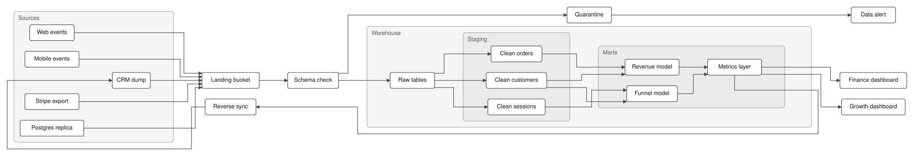

elk

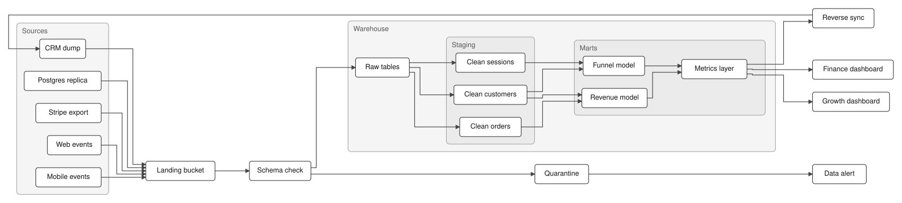


### 05-sign-in

own

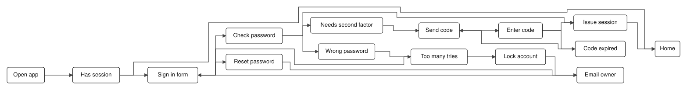

dagre

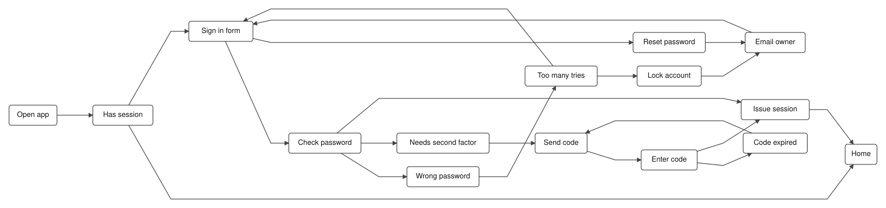

graphlay

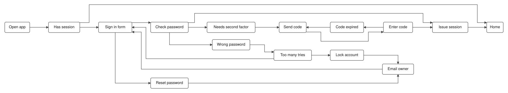

elk

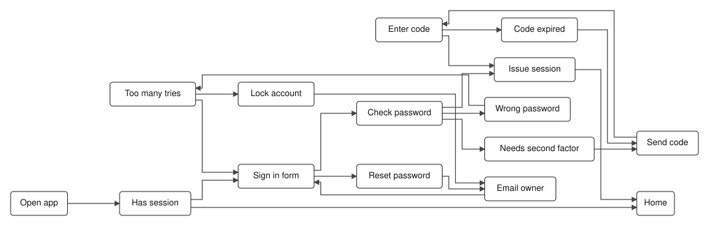


### 06-cluster-request

own

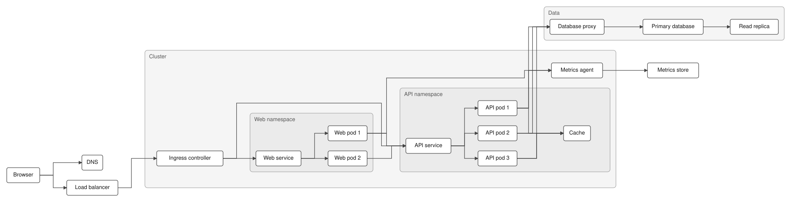

dagre

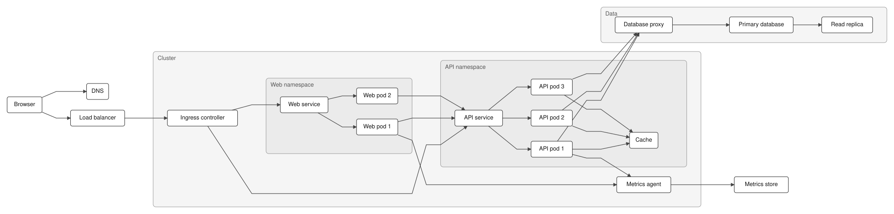

graphlay

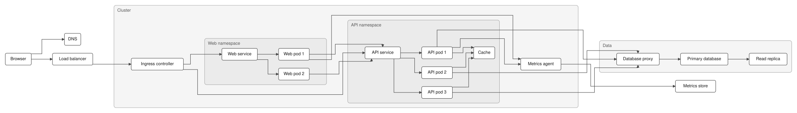

elk

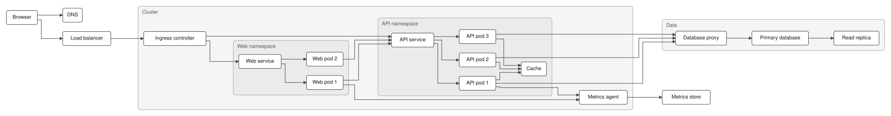


### 07-compiler

own

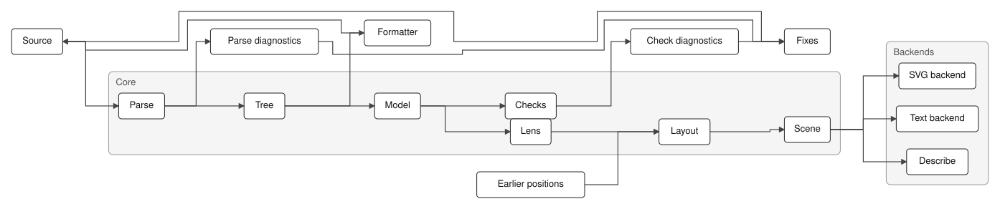

dagre

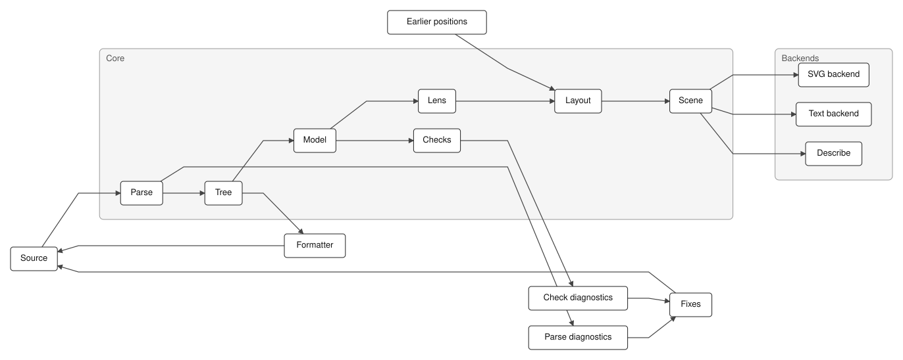

graphlay

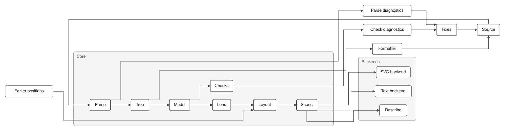

elk

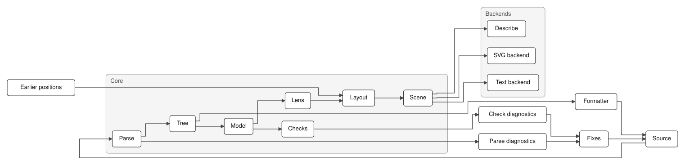


### 08-module-deps

own

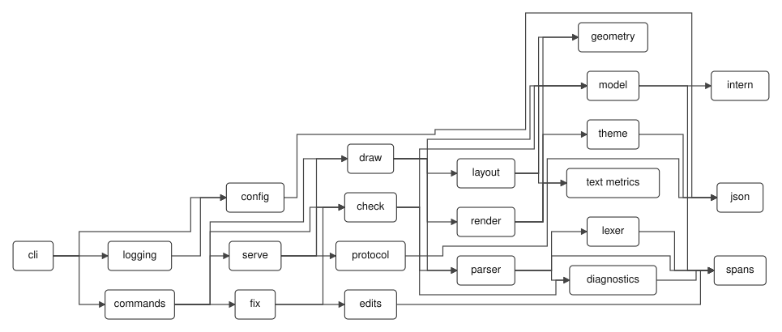

dagre

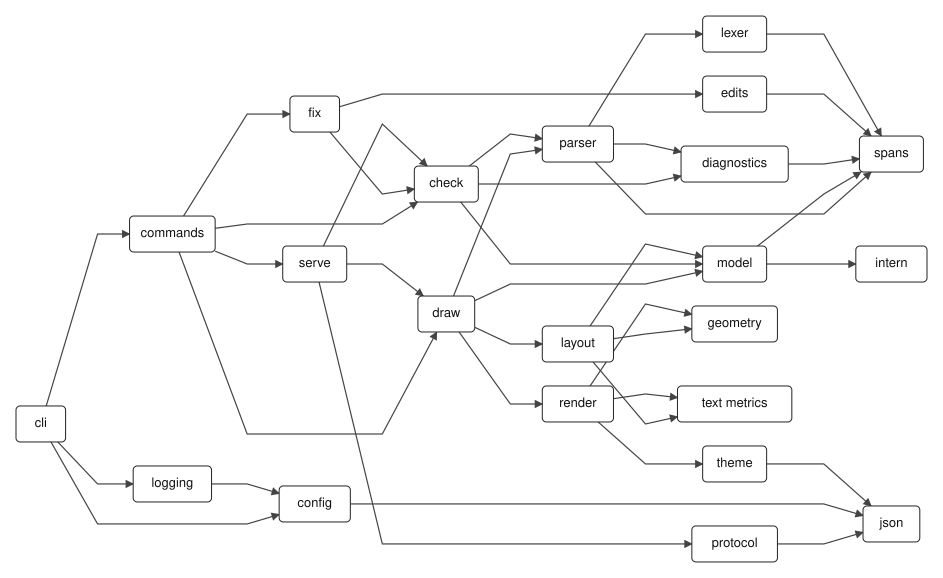

graphlay

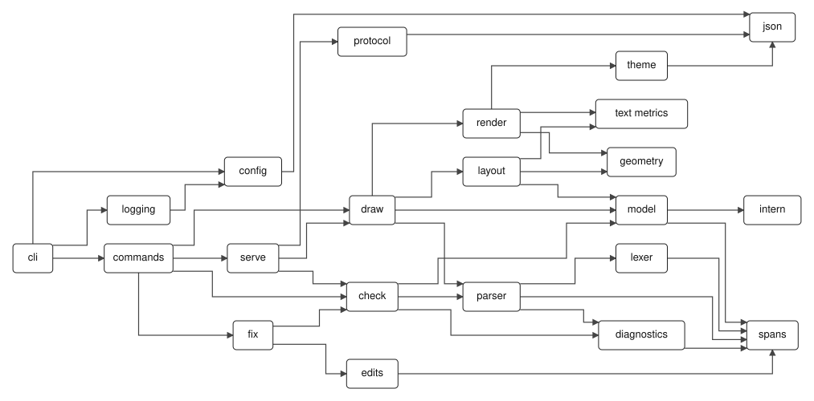

elk

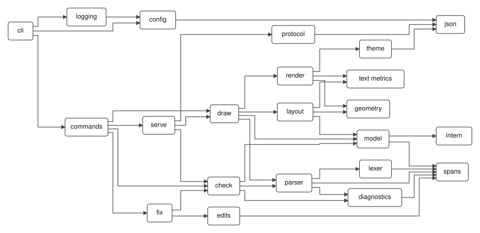


### 09-incident

own

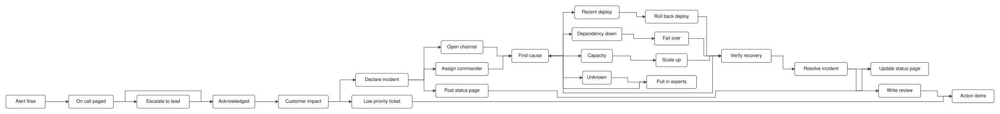

dagre

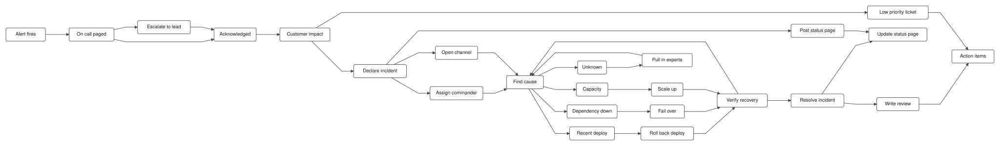

graphlay

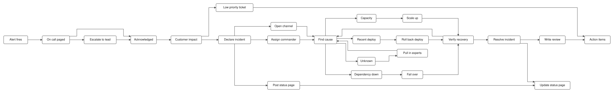

elk

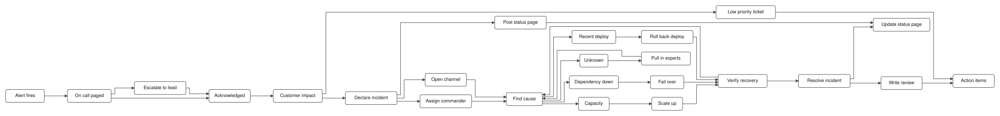


### 10-platform

own

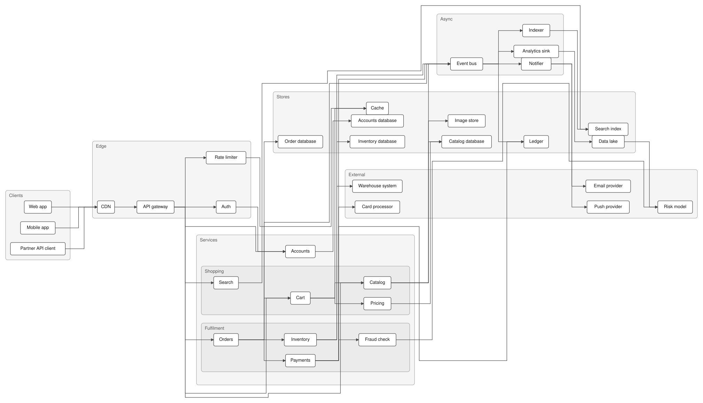

dagre

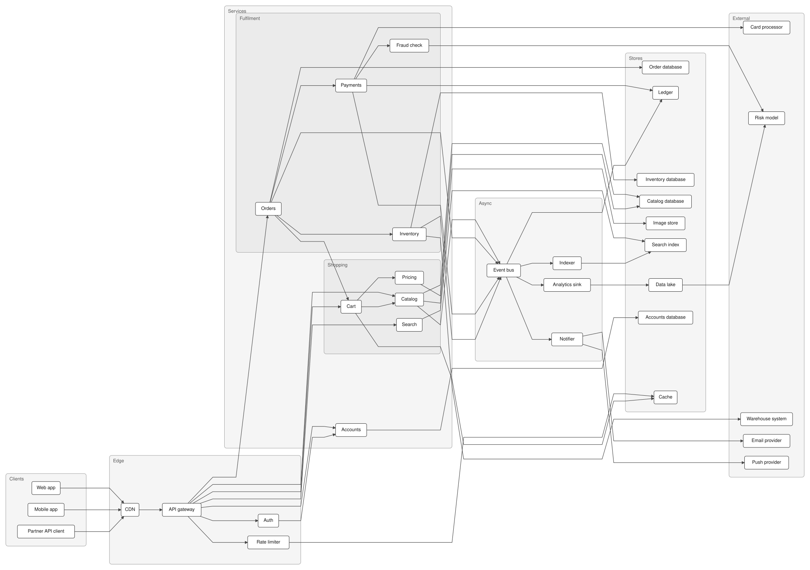

graphlay

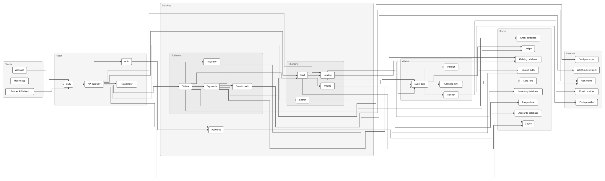

elk

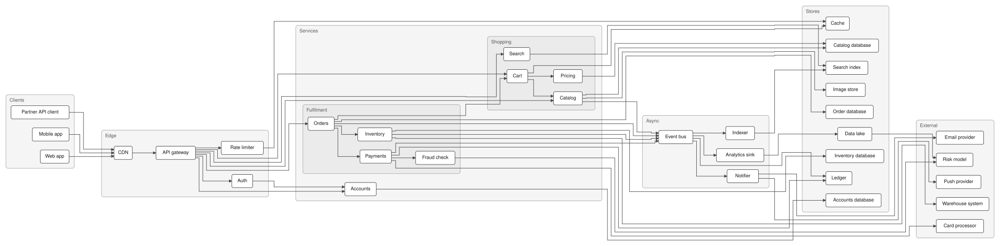

